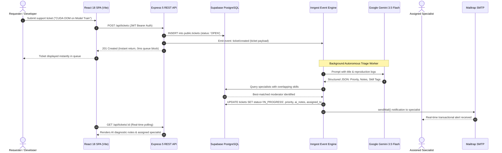

<div align="center">

# ⚡ Lysiq AI

### Autonomous IT Support Triage, Specialist Routing & Incident Lifecycle SaaS

[](https://github.com/Aritra-rickc2004/Lysiq-AI)
[](https://react.dev/)
[](https://www.typescriptlang.org/)
[](https://tailwindcss.com/)
[](https://expressjs.com/)
[](https://supabase.com/)
[](https://www.inngest.com/)
[](https://ai.google.dev/)
[](https://supabase.com/docs/guides/auth/row-level-security)
[](https://opensource.org/licenses/ISC)

<br/>

<p align="center">
  <b>An enterprise-grade, high-density IT operations platform engineered for zero-latency ticket submission, background AI diagnostic triage, dynamic specialist skill matching, full incident lifecycle resolution, and hardened single-super-admin governance.</b>
</p>

[Overview](#-overview) •
[Key Features](#-key-features) •
[Architecture & Event Flow](#-architecture--event-flow) •
[Design System](#-cinematic-precision-design-system) •
[Incident Lifecycle](#-incident-lifecycle--state-machine) •
[Tech Stack](#-tech-stack) •
[Security Architecture](#-security-architecture) •
[Getting Started](#-getting-started) •
[API Reference](#-api-reference) •
[Testing](#-testing--security-audit)

</div>

---

## 📖 Overview

Traditional enterprise IT ticketing systems suffer from sluggish manual triage queues, misallocated engineering bandwidth, and lengthy Mean Time to Resolution (MTTR). 

**Lysiq AI** solves this operational bottleneck with an asynchronous, event-driven architecture paired with Google's state-of-the-art **Gemini 3.5 Flash** model:

1. **Zero-Latency Incident Ingestion:** When a user files a support ticket, the Express REST API immediately commits the record to Supabase PostgreSQL and emits an asynchronous event to the Inngest broker, returning HTTP 201 in milliseconds.
2. **Autonomous Background AI Triage:** Inngest workers consume the ticket event in the background, invoking **Google Gemini 3.5 Flash** to extract root causes, synthesize moderator diagnostic notes, classify urgency (`LOW`, `MEDIUM`, `HIGH`, `CRITICAL`), and extract necessary technical skill tags (e.g. `PyTorch`, `CUDA`, `PostgreSQL`, `Docker`).
3. **Skill-Based Specialist Dispatch:** The agent queries available team specialists in PostgreSQL, computes an array intersection with their registered skill competencies, and automatically assigns the incident to the best-suited on-duty moderator.
4. **Instant Telemetry & Alerts:** Transactional notifications are dispatched to the assigned engineer via Nodemailer with Mailtrap SMTP transport.
5. **Full Resolution & Closure Workflows:** Authoritative transition controls allow Support Specialists and Admins to provide solutions, mark tickets as **`RESOLVED`**, and move verified incidents to **`CLOSED`**.
6. **Hardened Single Super Admin Governance:** The platform enforces an ironclad, database-level constraint guaranteeing that exactly one Super Admin exists across the entire system.

---

## 🚀 Key Features

### 🖥️ Desktop-First Operations Dashboard (React 18 + Vite + Tailwind)
- **High-Density Telemetry:** Live incident counters tracking Total Queue, In-Progress Triage, Resolved/Closed completion rates, and High-Priority bottlenecks with sub-pixel indicator dots.
- **Search & Multi-Facet Filtering:** Instant full-text search across ticket titles, descriptions, and IDs, paired with sunken segmented status filters (`ALL`, `OPEN`, `IN_PROGRESS`, `RESOLVED`, `CLOSED`).
- **Dedicated AI Agent Triage Inspector:** Real-time inspector panel on ticket detail views rendering Gemini 3.5 Flash analysis, diagnostic confidence notes, extracted skill tags, and audit trails.
- **Specialist Roster & Skills Directory:** Administrative roster view displaying team members, role assignments (`user`, `moderator`, `admin`), registered proficiencies, and AI routing readiness.
- **Autofill Dark-Mode Compatibility:** Full WebKit browser autofill overrides to ensure credential fields remain seamless in dark mode without glare.

### 🧠 Autonomous Gemini 3.5 Flash AI Pipeline
- **Non-blocking Event Decoupling:** Decouples user-facing HTTP responses from LLM latency via Inngest background event orchestration.
- **Deterministic Structured Output:** Leverages structured schema prompting to guarantee schema-valid priority values, technical skill tags, and diagnostic recommendations with zero hallucination.
- **Graceful Fallback Routing:** Intelligently defaults to unassigned triage queues if no registered moderator possesses the required skill profile.

### 🔄 End-to-End Incident Lifecycle Management
- **Stage Progression:** Visual stage progression indicator (`Open` → `In Progress` → `Resolved` → `Closed`) tracking every transition.
- **Resolution Solution Tracking:** Captures formal resolution notes explaining root causes, mitigation steps, and patch verification.
- **Role-Based Action Guards:** Requesters can inspect and close their own verified tickets; Specialists and Admins can diagnose, resolve, and close organizational tickets.

### 🛡️ Ironclad Single Super Admin Security
- **Unique Partial Index:** Enforced at storage level via PostgreSQL `CREATE UNIQUE INDEX ... WHERE role = 'admin'`.
- **Database Triggers:** Native PL/pgSQL triggers abort multi-admin creation, unauthorized role updates, or admin deletions.
- **Row Level Security (RLS):** Granular Supabase RLS policies safeguard tables against direct unauthorized client queries.

---

## 🏗️ Architecture & Event Flow



---

## 🎨 "Cinematic Precision" Design System

The Lysiq AI interface utilizes the **Cinematic Precision** dark-mode design system, crafted for mission-critical telemetry, developer dashboards, and low-latency incident triage:

| Design Token | Hex Code | Purpose |
| :--- | :--- | :--- |
| **Void Canvas** | `#0E0E0F` | True deep-space dark background that eliminates glare |
| **Docked Surface** | `#101112` | Sidebar, top header navigation, and table containers |
| **Card / Panel** | `#151617` | Incident cards, modals, and inspector panels |
| **Sub-Surface Well** | `#0B0B0C` | Form inputs, search fields, textareas, and code blocks |
| **Hairline Dividers** | `#1B1C1E` | Ultra-subtle interior separators between rows and sections |
| **Perimeter Borders** | `#232426` | Structural outer borders defining cards and modals |
| **Optical Glint** | `inset 0 1px 0 rgba(255,255,255,0.08)` | Top-edge light refraction shimmer (`card-inner-glow`) |
| **Primary Accent** | `#5E6BFF` (Electric Blurple) | Interactive CTAs, primary buttons, and selected states |
| **Telemetry Cyan** | `#50D8E9` | Active status indicators, AI pipeline telemetry, and link highlights |
| **Status Dots** | `6px` Micro-Indicators | Precision status signaling (`#50D8E9`, `#FFB689`, `#47E266`, `#FFB4AB`) |
| **Typography** | `Manrope` + `Inter` + `JetBrains Mono` | Headings, body text, and monospace IDs/telemetry |

---

## 🔄 Incident Lifecycle & State Machine

```
   ┌─────────┐         Autonomous Triage         ┌─────────────┐
   │  OPEN   │  ───────────────────────────────► │ IN PROGRESS │
   └─────────┘     (Gemini 3.5 Flash Assigned)    └─────────────┘
                                                        │
                                                        │ Specialist provides solution
                                                        ▼
   ┌─────────┐       Verified & Confirmed        ┌─────────────┐
   │ CLOSED  │  ◄─────────────────────────────── │  RESOLVED   │
   └─────────┘    (Requester or Super Admin)     └─────────────┘
```

* **`OPEN`**: Ticket submitted by requester; awaiting background Inngest worker pickup.
* **`IN_PROGRESS`**: Gemini 3.5 Flash has synthesized diagnostic notes, assigned urgency, and dispatched the incident to a matching specialist.
* **`RESOLVED`**: The specialist has applied a fix, documented the solution in the resolution notes, and made it available for testing.
* **`CLOSED`**: The requester or admin has verified the fix, officially archiving the incident.

---

## 🛠️ Tech Stack

| Domain | Technology | Description |
| :--- | :--- | :--- |
| **Frontend Framework** | [React 18](https://react.dev/) + [Vite 6](https://vitejs.dev/) | High-performance SPA with sub-second HMR |
| **Language** | [TypeScript](https://www.typescriptlang.org/) / [Node.js (ESM)](https://nodejs.org/) | Type-safe client and modular backend |
| **Styling** | [Tailwind CSS v3](https://tailwindcss.com/) | Custom Cinematic Precision design tokens |
| **Icons** | [Lucide React](https://lucide.dev/) | Consistent, lightweight vector icon suite |
| **Backend Framework** | [Express 5](https://expressjs.com/) | Clean REST routing, controllers, and middleware |
| **Database** | [Supabase](https://supabase.com/) (PostgreSQL 15) | Relational database with RLS and PL/pgSQL triggers |
| **Workflow Engine** | [Inngest](https://www.inngest.com/) | Serverless background event-driven orchestration |
| **AI LLM Model** | [Google Gemini 3.5 Flash](https://ai.google.dev/) | Autonomous incident triage & skill extraction |
| **Email Transport** | [Nodemailer](https://nodemailer.com/) + [Mailtrap](https://mailtrap.io/) | Transactional specialist alerts and SMTP testing |
| **Authentication** | [bcrypt](https://github.com/kelektiv/node.bcrypt.js) + [JWT](https://jwt.io/) | Secure password hashing & Bearer token sessions |

---

## 📁 Repository Structure

```
Lysiq-AI/
├── controllers/
│   ├── ticket.js                    # Ticket CRUD, resolution, and status transition logic
│   └── user.js                      # Authentication, JWT issuance, and team roster logic
├── Inngest/
│   ├── client.js                    # Inngest client configuration (ID: lysiq-ai)
│   └── functions/
│       ├── on-signup.js             # Automated user onboarding workflow
│       └── on-ticket-create.js      # Gemini 3.5 Flash autonomous triage & routing
├── middleware/
│   └── auth.js                      # JWT verification & Single Super Admin guards
├── routes/
│   ├── ticket.js                    # REST endpoints for /api/tickets
│   └── user.js                      # REST endpoints for /api/users
├── scripts/
│   ├── provision-super-admin.js     # Secure Single Super Admin provisioning CLI
│   ├── backfill-stuck-tickets.js    # Self-healing database triage recovery script
│   └── test-live-flow.js            # End-to-end integration test runner
├── supabase/
│   └── migrations/
│       └── 20261029_single_super_admin.sql # Indexes, PL/pgSQL triggers, and RLS policies
├── tests/
│   └── security.test.js             # Automated 5-layer security audit suite
├── utils/
│   ├── ai.js                        # Google Gemini 3.5 Flash SDK triage agent
│   ├── mailer.js                    # Nodemailer SMTP transport service
│   └── supabase.js                  # Supabase PostgreSQL client initialization
├── frontend/
│   ├── src/
│   │   ├── api/                     # Axios client and API services (auth, tickets, users)
│   │   ├── components/
│   │   │   ├── common/              # Button, Badge, Modal, EmptyState primitives
│   │   │   ├── layout/              # AppLayout, Sidebar, Header components
│   │   │   └── tickets/             # CreateTicketModal with Gemini telemetry
│   │   ├── context/                 # AuthContext with token & user state persistence
│   │   ├── types/                   # TypeScript domain definitions (Ticket, User, Role)
│   │   ├── views/                   # DashboardView, TicketsView, TicketDetailView, TeamView, AuthView
│   │   ├── App.tsx                  # Root application router and layout coordinator
│   │   ├── index.css                # Cinematic Precision glow, scrollbar, and autofill CSS
│   │   └── main.tsx                 # React DOM mount point
│   ├── index.html                   # HTML entry point with Manrope, Inter & JetBrains Mono
│   ├── package.json                 # Frontend dependencies & Vite scripts
│   ├── tailwind.config.js           # Extended Cinematic Precision color & shadow palette
│   └── vite.config.ts               # Vite build and proxy configuration
├── .env.example                     # Environment configuration template
├── .gitignore                       # Git ignore rules protecting credentials
├── index.js                         # Backend Express server entry point
├── package.json                     # Root project dependencies & scripts
└── README.md                        # Documentation
```

---

## 🔐 Security Architecture

Lysiq AI implements a comprehensive **5-Layer Defense Architecture** enforcing the Single Super Admin principle:

| Layer | Defense Mechanism | Failure Behavior |
| :--- | :--- | :--- |
| **1. Database Storage** | `CREATE UNIQUE INDEX enforce_single_super_admin_idx ON public.users(role) WHERE role = 'admin'` | PostgreSQL rejects any duplicate admin row at the storage engine level. |
| **2. Database Triggers** | `trg_enforce_single_super_admin` & `trg_protect_super_admin` | Raises a SQL `SECURITY VIOLATION` exception if an insert or update attempts to create a second admin or demote the existing admin. |
| **3. Row Level Security** | Policies `Prevent public admin creation` & `Prevent public admin promotion` | Blocks unprivileged Supabase requests from escalating their role to `admin`. |
| **4. Backend API Guards** | `POST /api/users/signup` and `PUT /api/users/update` | Explicitly rejects `role: 'admin'` with HTTP 403 Forbidden; validates caller identity via `requireSuperAdmin`. |
| **5. Frontend UI Controls** | `AuthView.tsx` & `TeamView.tsx` | Super Admin option is completely removed from public signup; admin rows in the specialist roster have disabled/protected role selectors. |

---

## ⚙️ Getting Started

Follow these step-by-step instructions to run Lysiq AI locally on your development machine.

### Prerequisites

- [Node.js](https://nodejs.org/) (v18.0.0 or later)
- [npm](https://www.npmjs.com/) (v9.0.0 or later)
- A free [Supabase](https://supabase.com/) project
- A free [Google AI Studio](https://aistudio.google.com/) API Key (for Gemini 3.5 Flash)
- A free [Mailtrap](https://mailtrap.io/) account (for SMTP email testing)

---

### Step 1: Clone the Repository

```bash
git clone https://github.com/Aritra-rickc2004/Lysiq-AI.git
cd Lysiq-AI
```

---

### Step 2: Install Dependencies

```bash
# 1. Install backend dependencies
npm install

# 2. Install frontend dependencies
cd frontend
npm install
cd ..
```

---

### Step 3: Configure Environment Variables

Create a `.env` file in the root directory by copying `.env.example`:

```bash
cp .env.example .env
```

Populate `.env` with your actual credentials:

```env
# Server Configuration
PORT=3000
APP_URL=http://localhost:3000
INNGEST_DEV=1

# Supabase PostgreSQL Configuration
SUPABASE_URL=https://your-project-id.supabase.co
SUPABASE_SERVICE_ROLE_KEY=your_supabase_service_role_secret_key

# JWT Authorization Secret
JWT_SECRET=your_custom_jwt_secret_key_here

# Mailtrap SMTP Configuration
MAILTRAP_SMTP_HOST=sandbox.smtp.mailtrap.io
MAILTRAP_SMTP_PORT=2525
MAILTRAP_SMTP_USER=your_mailtrap_username
MAILTRAP_SMTP_PASS=your_mailtrap_password
MAIL_FROM="Lysiq AI" <support@lysiq.ai>

# Google Gemini AI Configuration
GEMINI_API_KEY=your_google_gemini_api_key_here
```

---

### Step 4: Apply Database Schema & Migrations

1. Log into your **Supabase Dashboard** > **SQL Editor**.
2. Open and run the migration file:
   [`supabase/migrations/20261029_single_super_admin.sql`](./supabase/migrations/20261029_single_super_admin.sql)
3. This creates the `users` and `tickets` tables, applies the single-admin unique index, triggers, and Row Level Security policies.

---

### Step 5: Provision the Single Super Admin Account

Execute the secure CLI provisioning script to establish your exclusive Super Admin account:

```bash
node scripts/provision-super-admin.js --email "admin@company.com" --password "YourStrongPassword123!"
```

*(Or run `npm run provision:admin` for an interactive terminal prompt).*

---

### Step 6: Start Development Services

Open **three terminal windows** to run the complete stack:

#### Terminal 1: Backend Express Server
```bash
npm run dev
# Starts backend API on http://localhost:3000
```

#### Terminal 2: Inngest Background Dev Server
```bash
npx inngest-cli@latest dev -u http://localhost:3000/api/inngest
# Starts Inngest UI on http://localhost:8288
```

#### Terminal 3: Frontend Client
```bash
npm run client
# Starts Vite SPA on http://localhost:5173
```

Visit **`http://localhost:5173`** in your browser and sign in with your provisioned Super Admin credentials!

---

## 📡 API Reference

### Authentication & Team Management (`/api/users`)

| Method | Endpoint | Access | Description |
| :--- | :--- | :--- | :--- |
| `POST` | `/api/users/signup` | Public | Register a new account (`user` or `moderator` only). |
| `POST` | `/api/users/login` | Public | Authenticate with email/password and obtain JWT. |
| `POST` | `/api/users/logout` | Authenticated | Clears user session. |
| `GET` | `/api/users` | Admin Only | List all registered members, roles, and skills. |
| `PUT` | `/api/users/update` | Admin Only | Update member skills or promote `user` to `moderator`. |

### Tickets & Incident Lifecycle (`/api/tickets`)

| Method | Endpoint | Access | Description |
| :--- | :--- | :--- | :--- |
| `POST` | `/api/tickets` | Authenticated | Submit an incident ticket and trigger Inngest AI triage. |
| `GET` | `/api/tickets` | Authenticated | List accessible tickets with filters (`status`, `priority`, `search`). |
| `GET` | `/api/tickets/:id` | Authenticated | Retrieve full ticket detail, timeline, and Gemini 3.5 Flash notes. |
| `PUT` | `/api/tickets/:id/status` | Authorized | Transition status (`RESOLVED`, `CLOSED`) with resolution notes. |

---

## 🧪 Testing & Security Audit

Lysiq AI includes an automated security audit test suite verifying single-admin enforcement, privilege escalation protection, and endpoint security:

```bash
node tests/security.test.js
```

### Verified Test Results:

```
=======================================================
 🔒 RUNNING AUTOMATED SECURITY & SINGLE-ADMIN AUDIT
=======================================================

1. Testing Public Signup Admin Rejection...
✅ PASS: Signup with role='admin' must be rejected with 403 Forbidden (got 403)
✅ PASS: Error message explicitly identifies prohibited admin registration

2. Testing Unauthorized Access to Role Updates...
✅ PASS: Unauthenticated PUT /api/users/update must be rejected with 401 (got 401)

3. Testing Privilege Escalation by Standard User...
✅ PASS: Non-admin attempting PUT /api/users/update must be rejected with 403 (got 403)

4. Testing Privilege Escalation by Moderator...
✅ PASS: Moderator attempting PUT /api/users/update must be rejected with 403 (got 403)

5. Testing Admin Attempting to Create a Second Admin...
✅ PASS: Attempting to assign role='admin' must be rejected with 403 (got 403)
✅ PASS: Error explicitly states promoting to admin via API is strictly prohibited

=======================================================
 RESULTS: 7 passed, 0 failed
=======================================================
```

---

## 🤝 Contributing

Contributions are welcome! Please follow these steps:

1. Fork the repository.
2. Create your feature branch (`git checkout -b feature/NewFeature`).
3. Commit your changes (`git commit -m 'feat: add new feature'`).
4. Push to the branch (`git push origin feature/NewFeature`).
5. Open a Pull Request.

---

## 📄 License

This project is licensed under the **ISC License**. See the [LICENSE](LICENSE) file for details.

---

<div align="center">
  <b>Built with ⚡ by <a href="https://github.com/Aritra-rickc2004">Aritra</a></b>
</div>
